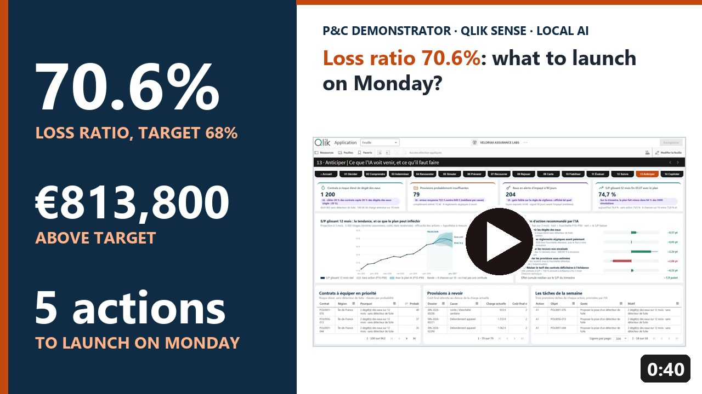
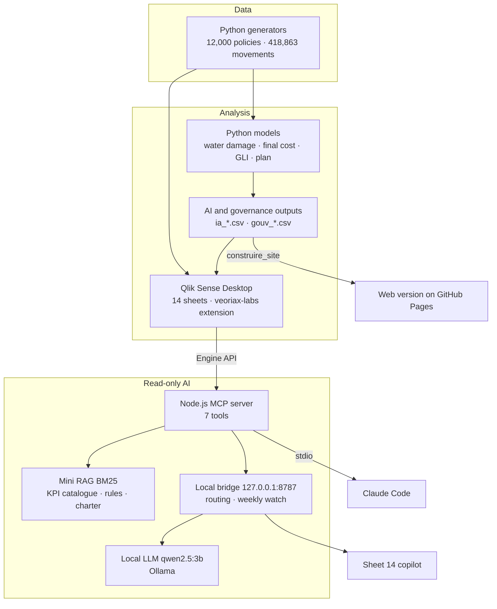
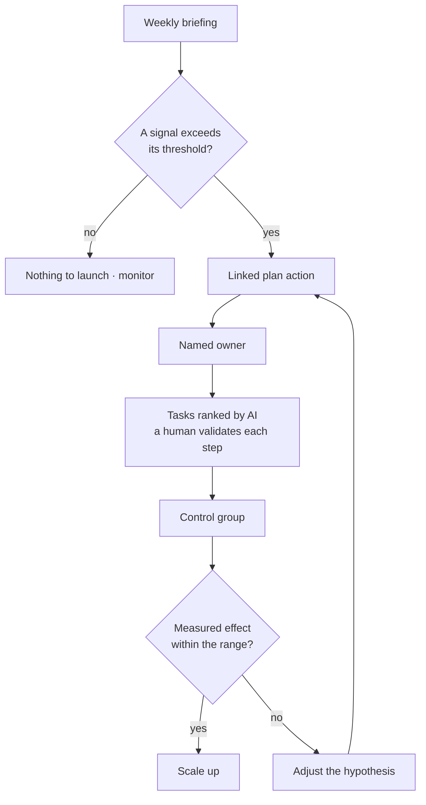
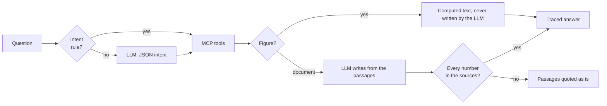

# Veloriax Assurance Labs: from "what happened" to "what we launch on Monday"

<a href="README.md"></a>&nbsp;<a href="README.en.md"></a>

## The project in a video

<table>
  <tr>
    <td width="420" valign="top">
      <a href="https://cnanaj-wq.github.io/veloriax-assurance-labs/video.html"></a>
    </td>
    <td valign="top">
      <a href="https://cnanaj-wq.github.io/veloriax-assurance-labs/video.html"><b>Loss ratio at 70.6% against a 68% target: what do we launch on Monday?</b></a><br><br>
      Cédric NANA · Data Analytics Consultant<br>
      ▷ 0:40 · no voice-over, on-screen text in French<br><br>
      Qlik Sense measures, three Python models anticipate, a traceable copilot answers: the project in 40 seconds.
    </td>
  </tr>
</table>

**Open the interactive dashboard: https://cnanaj-wq.github.io/veloriax-assurance-labs/** (in French)


> Diagrams drawn with Excalidraw and editable: open [design/fil-du-projet.excalidraw](design/fil-du-projet.excalidraw)
> or [design/architecture.excalidraw](design/architecture.excalidraw) on [excalidraw.com](https://excalidraw.com) (Menu › Open).

## The project

An "augmented BI" demonstrator for property & casualty insurance (home insurance and rent guarantee, "GLI").
It starts from a classic Qlik Sense dashboard and adds what usually sits between the finding and the decision:
models that anticipate, an action plan quantified as a range, a weekly briefing and a copilot that answers
while citing its sources. Everything runs locally, read-only, on **synthetic data**.

## The business need

A P&C technical department sees its loss ratio (claims / premiums, "S/P") drift. The dashboard says *how much*;
it says neither *why*, nor *what will happen*, nor *what to do*. Three questions come back every week:

1. **Where does the gap to target come from?** Which region, which cover, which files.
2. **What happens if we do nothing?** A quantified trend, with its uncertainty.
3. **What do we launch on Monday, and who owns it?** Concrete actions, an owner, a way to measure effect.

Starting point: **2026 loss ratio of 70.6% against a 68% target**, i.e. **€813,800** of claims above target
on €31.8M of premiums.

## The solution

| Step | What was done | Tool |
|---|---|---|
| 1. Reliable figures | 12 governed KPIs (definition, rule, owner), 8 blocking load checks | Qlik Sense load script |
| 2. Understand | 12 business sheets: gap by region, weight of each cover (water damage = 39.8% of claims) | Qlik Sense |
| 3. Anticipate | 3 models validated on an unseen period: water damage within 10 months, final claim cost, first rent default within 90 days | Python, scikit-learn |
| 4. Act | 5 actions quantified as ranges (5,000 simulations), one owner each, tasks ranked by AI | Sheet 13 "Anticiper" |
| 5. Ask | Copilot: 7 read-only tools, every answer shows the tools queried and the documents cited | MCP server, local LLM, sheet 14 |
| 6. Learn | Weekly briefing: 5 signals with threshold and owner; control group before scaling up | Watch agent |

Trust guarantees, applied everywhere:

- **Read-only**: the copilot changes no premium, no reserve, no decision.
- **Figures are computed, never written by the LLM**: the local LLM only understands the question and rephrases documents; an answer is rejected if it contains a number missing from the sources.
- **Traceability**: every figure is quoted with the tool or document it comes from.
- **Humans decide**: a score is a probability, a projection a range, an effect a hypothesis to measure.

## Architecture




- **Qlik Sense remains the source of truth**: the MCP server queries the app through the Engine API (session objects, nothing saved).
- **The LLM is local** (Ollama): no data leaves the machine.
- **The web version** reuses the same outputs through `source/ia/construire_site.mjs`, which writes `data.js`.

### Operating scenarios

| Situation | What happens | What the user sees |
|---|---|---|
| Numeric question ("Where does the gap come from?") | Intent rule → MCP tools → computed text | Answer, tools queried, sources |
| Unrecognised free question | The LLM classifies the intent (JSON), then same tools | Computed answer, engine shown |
| Definition question ("How is the loss ratio computed?") | Governed catalogue, otherwise RAG + checked writing | Definition, rule, owner, cited document |
| LLM missing or stopped | Rules only | The copilot answers, without rephrasing |
| Local bridge stopped | Sheet 14 replays the recorded sessions | Badge "Hors ligne · sessions enregistrées" |
| Qlik closed | The tool fails, the bridge returns the error | Error message, no invented answer |
| Monday morning | Watch agent: 5 signals evaluated | Weekly briefing, alert and owner |

## Decision flow



And the path of a question asked to the copilot:



| Signal (briefing) | Threshold | Owner | Action |
|---|---|---|---|
| Rolling 12-month loss ratio above target | + 3 points | Technical department | Full plan |
| Water damage > 35% of claims | 35% | Prevention | A1 leak detectors |
| Reserves probably too low | 50 files | Claims | A4 reserve adjustment |
| Recoveries to collect | €300,000 | Recovery team | A3 reminders |
| Rent-guarantee leases at risk of default | 150 leases | GLI management | Preventive contact |

## Business impact

- **Where to act**: Auvergne-Rhône-Alpes (€441,760), Occitanie and Provence-Alpes-Côte d'Azur concentrate the gap; water damage weighs 39.8% of claims.
- **Whom to target**: 963 high-risk water-damage policies without a leak detector; 455 uncollected recoveries (€588,047); 79 under-reserved claims; 204 rent-guarantee leases on alert.
- **What the plan can change**: over the next quarter, median loss ratio of 73.4% without action versus 72.4% with the plan; the plan does better in 94% of 5,000 scenarios. Chasing recoveries (A3) weighs most: €68,694 median over 3 months.
- **A trade-off made visible**: adjusting reserves (A4) worsens the loss ratio in the short term (–2.08 points) but avoids a bad surprise at closing.

To read it honestly: the 68% target cannot be reached in one quarter (rolling 12-month loss ratio of 74.7% at end of January 2027
with the plan, versus 74.9% without). The models beat a simple rule without being spectacular (AUC 0.64 versus 0.57 for water damage).
Effects are hypotheses to be measured with a control group. Nothing here is validated in production.

## Online dashboard

The web version reproduces five screens of the demonstrator without a Qlik licence (interface in French):

- **Synthèse**: gap by region (clickable) and weight of each cover.
- **Anticiper**: the 3 models, their evidence and limits, and the work lists they produce.
- **Plan d'action**: rolling loss-ratio fan chart, effect of each action as a range, tasks of the week.
- **Copilote**: recorded answers with their trace, weekly briefing.
- **Gouvernance**: AI usage charter, load checks, governed KPIs, model cards.

To open it locally:

```bash
python -m http.server 8000
```

then `http://localhost:8000`. The [source/](source/) folder holds the code: Qlik load scripts, data generators,
Python models, MCP server, bridge, watch agent and the `veoriax-labs` Qlik extension.

## Data source

**Fully synthetic data**, produced by the Python generators in `source/`: 12,000 home policies,
418,863 claim and premium movements, 4,094 rent-guarantee leases. No figure comes from a real insurer;
region names are only used to make the demonstration readable.

---

Cédric NANA · Data Analytics Consultant · Qlik Sense, Python, MCP, local generative AI
