# Veloriax Assurance Labs: from "what happened" to "what we launch on Monday"

<a href="README.md"></a>&nbsp;<a href="README.en.md"></a>

## The project in a video

<table>
  <tr>
    <td width="420" valign="top">
      <a href="https://cnanaj-wq.github.io/veloriax-assurance-labs/video.html"></a>
    </td>
    <td valign="top">
      <a href="https://cnanaj-wq.github.io/veloriax-assurance-labs/video.html"><b>Loss ratio at 70.6% against a 68% target: what do we launch on Monday?</b></a><br><br>
      Cédric NANA · Data Analytics Consultant<br>
      ▷ 0:40 · no voice-over, on-screen text in French<br><br>
      Qlik Sense measures, three Python models anticipate, a traceable copilot answers: the project in 40 seconds.
    </td>
  </tr>
</table>

**Open the interactive dashboard: https://cnanaj-wq.github.io/veloriax-assurance-labs/** (in French)

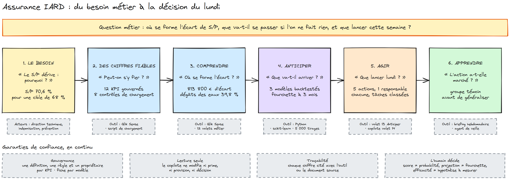

> Diagrams drawn with Excalidraw and editable: open [design/fil-du-projet.excalidraw](design/fil-du-projet.excalidraw)
> or [design/architecture.excalidraw](design/architecture.excalidraw) on [excalidraw.com](https://excalidraw.com) (Menu › Open).

## The project

An "augmented BI" demonstrator for property & casualty insurance (home insurance and rent guarantee, "GLI").
It starts from a classic Qlik Sense dashboard and adds what usually sits between the finding and the decision:
models that anticipate, an action plan quantified as a range, a weekly briefing and a copilot that answers
while citing its sources. Everything runs locally, read-only, on **synthetic data**.

## The business need

A P&C technical department sees its loss ratio (claims / premiums, "S/P") drift. The dashboard says *how much*;
it says neither *why*, nor *what will happen*, nor *what to do*. Three questions come back every week:

1. **Where does the gap to target come from?** Which region, which cover, which files.
2. **What happens if we do nothing?** A quantified trend, with its uncertainty.
3. **What do we launch on Monday, and who owns it?** Concrete actions, an owner, a way to measure effect.

Starting point: **2026 loss ratio of 70.6% against a 68% target**, i.e. **€813,800** of claims above target
on €31.8M of premiums.

## The solution

| Step | What was done | Tool |
|---|---|---|
| 1. Reliable figures | 12 governed KPIs (definition, rule, owner), 8 blocking load checks | Qlik Sense load script |
| 2. Understand | 12 business sheets: gap by region, weight of each cover (water damage = 39.8% of claims) | Qlik Sense |
| 3. Anticipate | 3 models validated on an unseen period: water damage within 10 months, final claim cost, first rent default within 90 days | Python, scikit-learn |
| 4. Act | 5 actions quantified as ranges (5,000 simulations), one owner each, tasks ranked by AI | Sheet 13 "Anticiper" |
| 5. Ask | Copilot: 7 read-only tools, every answer shows the tools queried and the documents cited | MCP server, local LLM, sheet 14 |
| 6. Learn | Weekly briefing: 5 signals with threshold and owner; control group before scaling up | Watch agent |

Trust guarantees, applied everywhere:

- **Read-only**: the copilot changes no premium, no reserve, no decision.
- **Figures are computed, never written by the LLM**: the local LLM only understands the question and rephrases documents; an answer is rejected if it contains a number missing from the sources.
- **Traceability**: every figure is quoted with the tool or document it comes from.
- **Humans decide**: a score is a probability, a projection a range, an effect a hypothesis to measure.

## The 15 tabs of the application

Screenshots of the Qlik Sense application (synthetic data, French interface). Each tab answers one specific question;
the [tab journey diagram](https://cnanaj-wq.github.io/veloriax-assurance-labs/diagrammes/parcours-onglets.html) shows how they connect.

| Tab | The question it answers |
|---|---|
| Accueil (Home) | How big is the portfolio? |
| 01 Décider (Decide) | Where is the gap to target, and what should be decided? |
| 02 Comprendre (Understand) | Which cover drives the claims cost? |
| 03 Indemniser (Settle) | Which claims are stuck or cost the most? |
| 04 Renouveler (Renew) | Which policies need review before renewal? |
| 05 Simuler (Simulate) | Is one prevention lever enough? |
| 06 Prévenir (Prevent) | Which rent-guarantee leases are at risk of arrears? |
| 07 Recouvrer (Recover) | Where do rent-arrears files stand? |
| 08 Rejouer (Replay) | How did the ratio drift month after month? |
| 09 Carte (Map) | Which territories and which risks? |
| 10 Fiabiliser (Reconcile) | Are the loaded figures right? |
| 11 Évaluer (Evaluate) | What proof should an AI solution provide? |
| 12 Suivre (Follow) | What journey did a customer follow? |
| 13 Anticiper (Anticipate) | What do the models see coming, and what to launch? |
| 14 Copiloter (Copilot) | What does the copilot answer, and from which sources? |

### Home · the entry point

Four portfolio figures: €31.84M of premiums, €22.47M of claims, a loss ratio (claims / premiums) of 70.6% against a 68% target,
12,000 policies across 120 agencies and 5 regions. The banner states that this is a prototype on synthetic data.

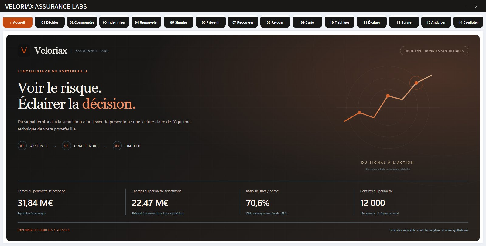

### 01 · Decide · spot the gap, explain it, decide, follow up

Five indicators with their monthly trend, including the gap to target (+€814k) and the number of regions above 68% (4 out of 5).
The loss ratio by region, against a 68% reference line, shows where to investigate: Auvergne-Rhône-Alpes at 74.9%, Île-de-France the only one below target at 61.5%.
The side panel follows the five steps of a decision (detect, explain, recommend, decide, follow up) and the table turns each region into euros of gap.

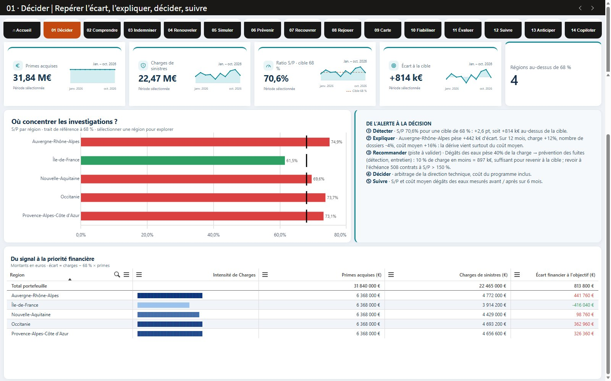

### 02 · Understand · where the claims cost concentrates

Claims by cover: water damage dominates (€8.97M, about 40%), ahead of fire, theft and vandalism.
A line chart compares premiums and claims month by month and a region × cover matrix crosses claims cost and number of entries.
The tab guides the investigation without claiming to prove a cause.

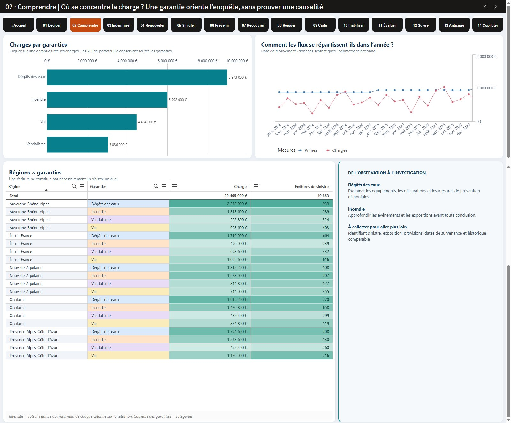

### 03 · Settle · claims, delays and recoveries

Six claims-handling indicators: 1,033 open claims, €1.67M of reserves, 6.3 days to report, 54 days of handling time, 32% of recoveries collected.
Charts show the backlog by age, the top 8 causes, the workload of the 15 handlers and the most heavily reserved claims.
A suspicion score built on four readable rules lists the claims to check (a signal directs the review, it does not prove fraud).

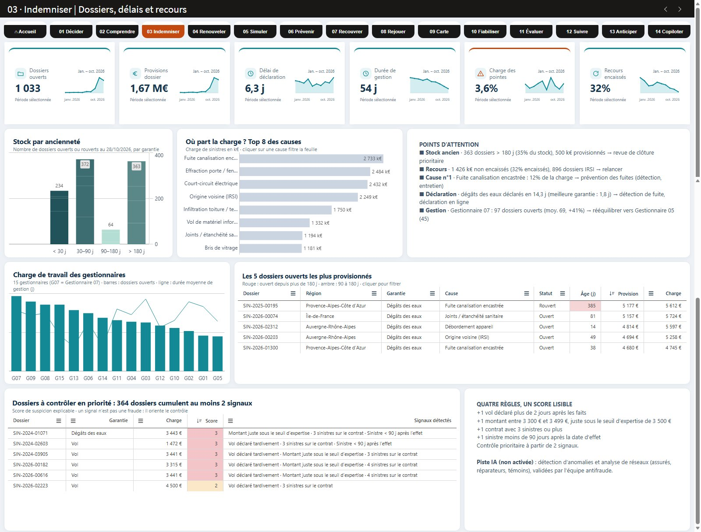

### 04 · Renew · profitability by segment and policies to review

Loss ratio by insured activity (coworking above 110%), the 6 agencies that widen the gap the most, then the 508 policies with a loss ratio above 150%
renewing within 3 months, each with a rule-based action (review the deductible, leak prevention) for the underwriter to validate.
A last chart crosses distribution channel and customer seniority.

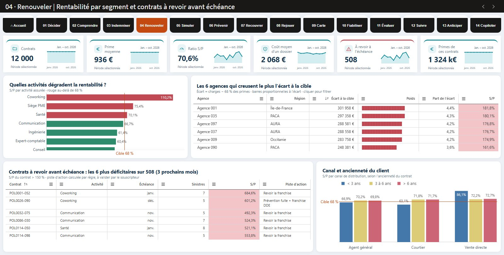

### 05 · Simulate · is one prevention lever enough?

Four buttons (0, 5, 10 or 20% reduction of water damage) recompute avoided claims, the simulated loss ratio and the remaining gap.
The before / after chart compares the target, the scenario and the current situation. The gain shown is gross, before programme cost:
the tab frames a pilot, it does not promise a result.

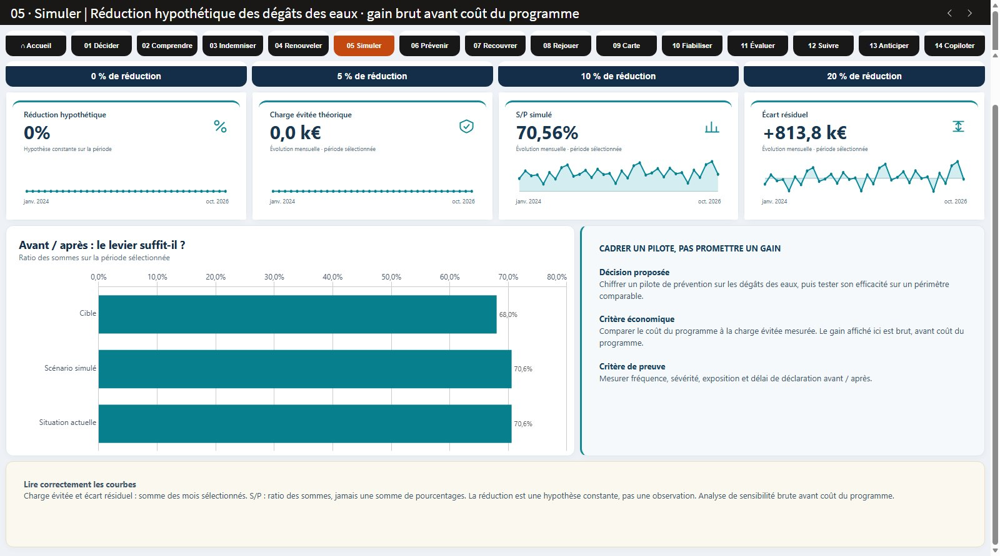

### 06 · Prevent · rent arrears, signals and interventions

For the rent guarantee (GLI): 2.2% arrears rate, 540 leases on high alert, 280 leases in arrears, a signal raised before the first missed rent in 34% of cases.
An explainable score (late payments, rent-to-income ratio, contract type) ranks the leases; the rent-to-income ratio stands out as the first risk factor.
Two work lists: the 5 leases to call this week with the proposed action, and 5 open files to unblock.

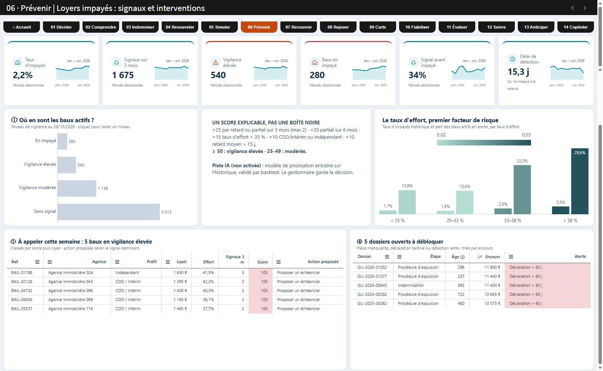

### 07 · Recover · tracking, delays and amounts

The rent-arrears journey step by step (first missed rent, reminder, formal notice, payment order, claim, indemnity, eviction, recovery, closure),
delays under automated or manual follow-up, the trend of new arrears, amounts indemnified and recovered per year, and performance by handler.
The [rent-arrears file lifecycle](https://cnanaj-wq.github.io/veloriax-assurance-labs/diagrammes/dossier-gli.html) details these steps.

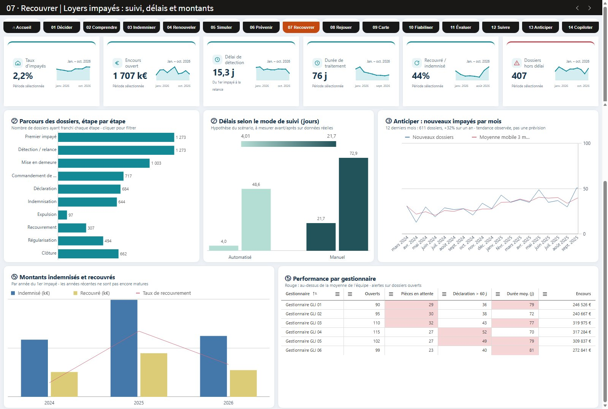

### 08 · Replay · claims month by month

A play button steps through the months from January 2024 to October 2026: the 12-month rolling loss ratio (74.4% at the end of October 2026), claims cost, average cost and claim count follow.
The region × cover matrix, the loss-ratio trajectory against target and a commentary on the replayed month show where the drift sets in.

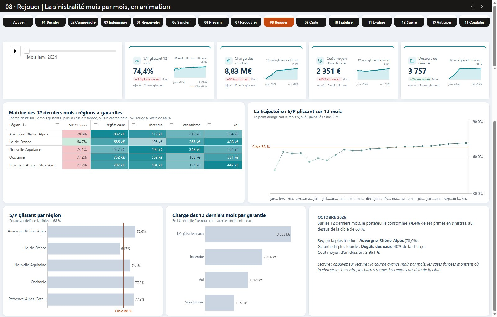

### 09 · Map · territories and covers

Six buttons choose the indicator shown on the regional map (premiums, claims, observed loss ratio, avoided claims, simulated loss ratio, remaining gap).
A second map places one pie chart per region to read the claims mix by cover.

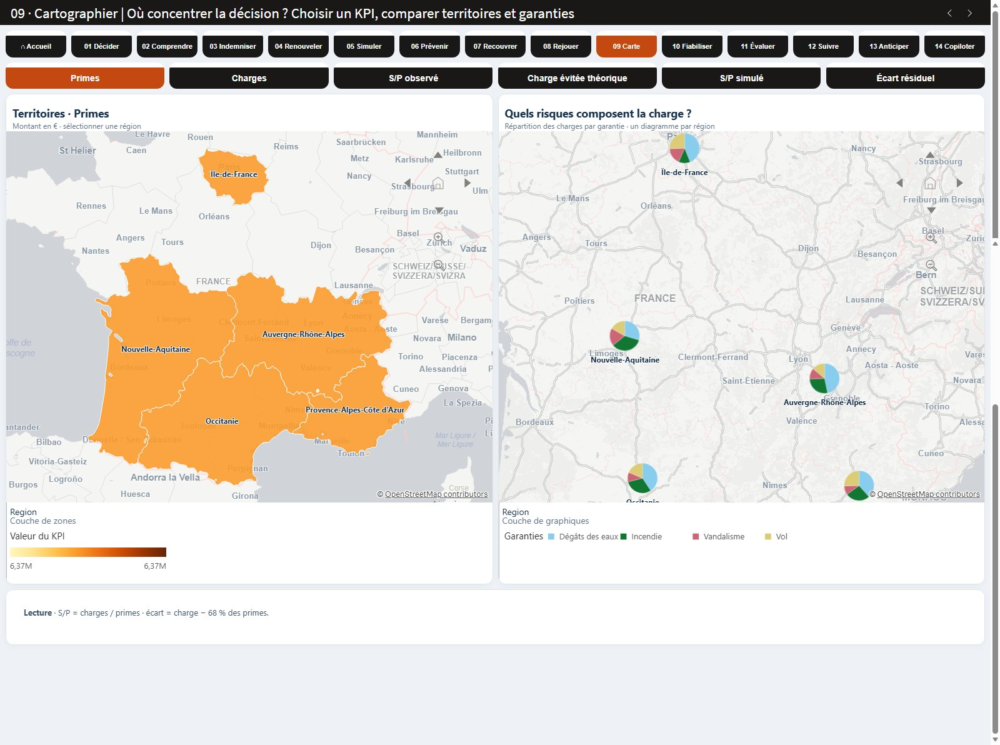

### 10 · Reconcile · source / engine checks

Eight checks, independent of selections, compare the sources with the loaded model: number of policies and movements, premium and claims totals,
duplicates, missing amounts, unknown types, orphan policies. All eight pass (€0 gap); the last reload time is shown.

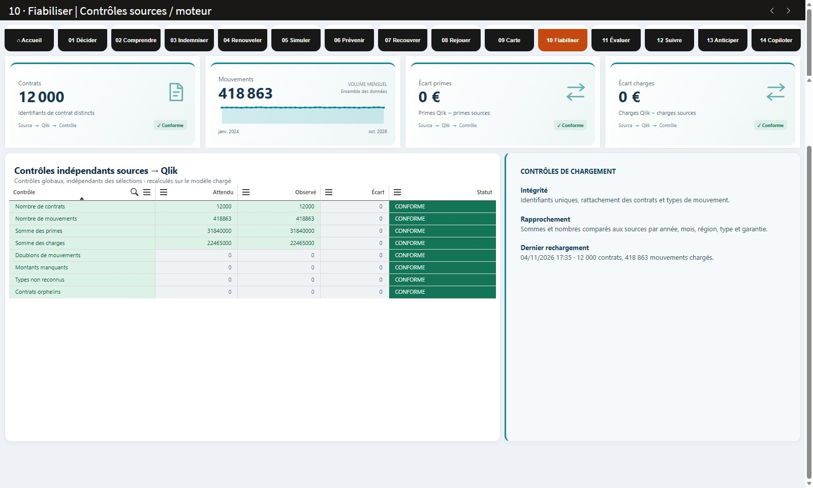

### 11 · Evaluate · AI solutions and proof

A catalogue of 28 AI use cases grouped by domain (claims, profitability, fraud, customer, climate, compliance). For each one: the proposed solution,
the outcome to measure, the proof to produce and the data required. The header says it plainly: 0 AI model validated here.

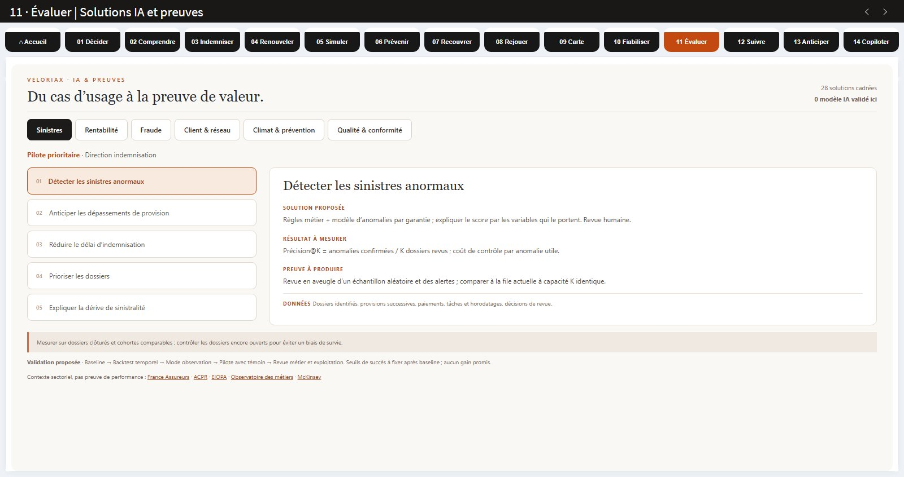

### 12 · Follow · subscription and cancellation

The timeline of a fictitious customer, from quote to cancellation, with the delay between steps. Three examples (cancelled customer, active customer, abandoned quote)
come from an independent CRM cohort of 1,200 customers and 6,800 events. A stated reason is not presented as a cause.

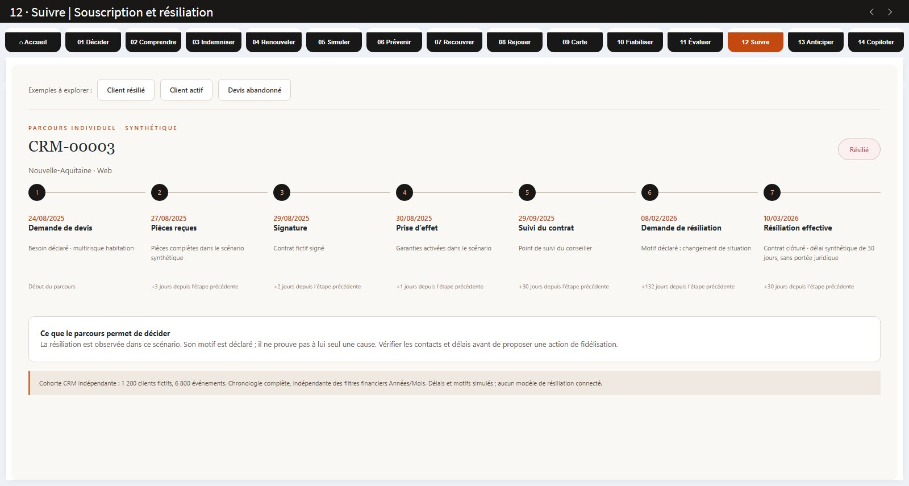

### 13 · Anticipate · what AI sees coming, and what to do

The outputs of the three models: 1,200 policies at high water-damage risk, 79 reserves likely too low, 204 leases on 90-day arrears alert.
The 3-month projection of the rolling loss ratio (5,000 draws) compares "no action" and "with the plan" as ranges. The plan lists 5 actions with their median effect;
three tables give the policies to equip, the reserves to review and this week's tasks.

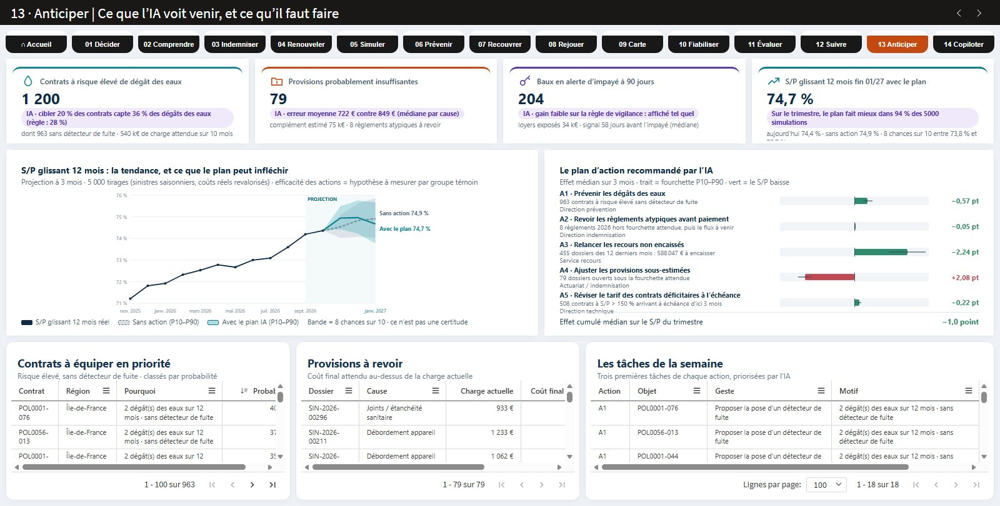

### 14 · Copilot · ask, verify, decide

The copilot answers questions about the portfolio and shows, under each answer, the tools queried and the documents cited.
Alongside: the governed KPIs (definition, rule, owner), the model cards with their limits and the AI usage charter.
The [copilot diagram](https://cnanaj-wq.github.io/veloriax-assurance-labs/diagrammes/copilote.html) traces the path of a question.

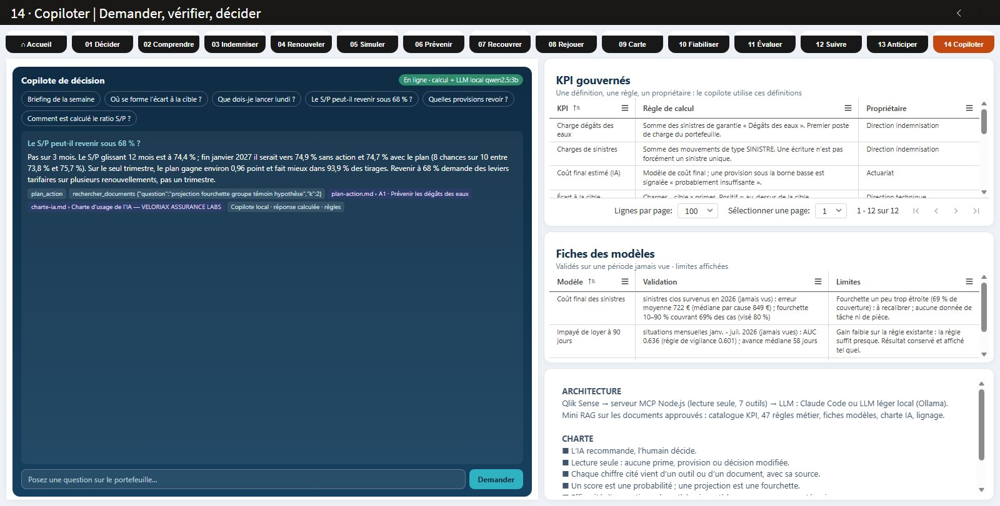

## Architecture

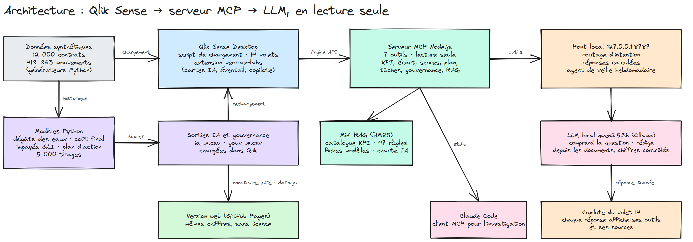

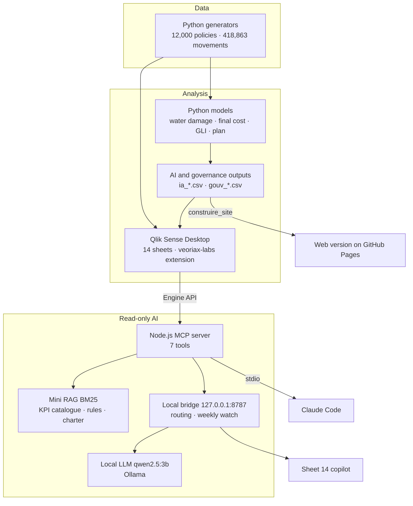

- **Qlik Sense remains the source of truth**: the MCP server queries the app through the Engine API (session objects, nothing saved).
- **The LLM is local** (Ollama): no data leaves the machine.
- **The web version** reuses the same outputs through `source/ia/construire_site.mjs`, which writes `data.js`.

### Operating scenarios

| Situation | What happens | What the user sees |
|---|---|---|
| Numeric question ("Where does the gap come from?") | Intent rule → MCP tools → computed text | Answer, tools queried, sources |
| Unrecognised free question | The LLM classifies the intent (JSON), then same tools | Computed answer, engine shown |
| Definition question ("How is the loss ratio computed?") | Governed catalogue, otherwise RAG + checked writing | Definition, rule, owner, cited document |
| LLM missing or stopped | Rules only | The copilot answers, without rephrasing |
| Local bridge stopped | Sheet 14 replays the recorded sessions | Badge "Hors ligne · sessions enregistrées" |
| Qlik closed | The tool fails, the bridge returns the error | Error message, no invented answer |
| Monday morning | Watch agent: 5 signals evaluated | Weekly briefing, alert and owner |

## Interactive diagrams

Five standalone HTML diagrams to explore in the browser (zoom, search, guided views, light or dark theme, export).
They are gathered on **https://cnanaj-wq.github.io/veloriax-assurance-labs/diagrammes/** (labels in French).

| Diagram | What it shows |
|---|---|
| [The 15-tab journey](https://cnanaj-wq.github.io/veloriax-assurance-labs/diagrammes/parcours-onglets.html) | The decision thread (Home → Decide → Understand → Simulate → Anticipate → Copilot), business zooms, context and trust |
| [From data to tabs](https://cnanaj-wq.github.io/veloriax-assurance-labs/diagrammes/donnees.html) | Python generators, 11 source files, AI enrichment, 19 reloaded files, 8 checks, delivery |
| [Rent-arrears file lifecycle](https://cnanaj-wq.github.io/veloriax-assurance-labs/diagrammes/dossier-gli.html) | From the first missed rent to closure: amicable path, insurance path, eviction case |
| [One question to the copilot](https://cnanaj-wq.github.io/veloriax-assurance-labs/diagrammes/copilote.html) | Rule-based routing, computation by tools, document search, controlled drafting |
| [Deployment](https://cnanaj-wq.github.io/veloriax-assurance-labs/diagrammes/deploiement.html) | Local workstation, Qlik Cloud, and Claude connected through the Qlik MCP connector |

The specifications live in [design/archify/](design/archify/); the diagrams are generated and validated with Archify.

### Qlik Cloud deployment and access from Claude

The application was also imported into a personal Qlik Cloud space: the QVF file, its 19 data files in DataFiles and the `veoriax-labs` extension.
The reload gives the same figures as the local version (€31.84M of premiums, 70.6% loss ratio, +€814k gap).
Claude queries it read-only through the tenant's Qlik MCP server after OAuth sign-in: for instance, four regions out of five above target
and €8.97M of water-damage claims. This tenant is a trial; the application is not published there.

## Decision flow

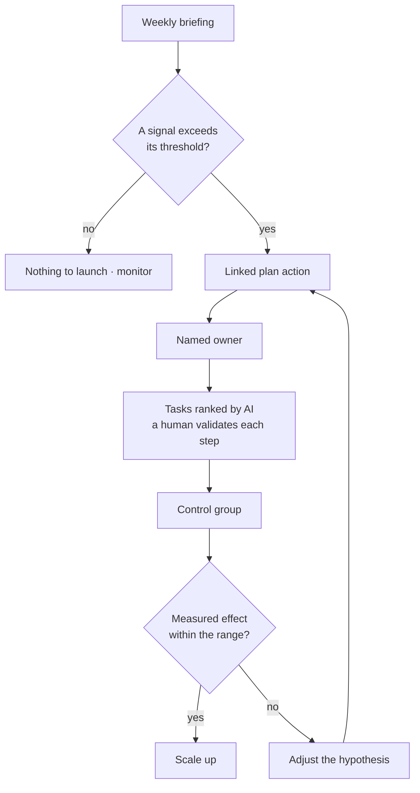

And the path of a question asked to the copilot:

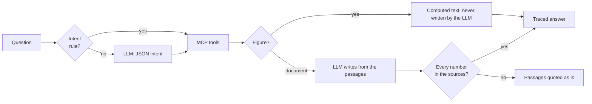

| Signal (briefing) | Threshold | Owner | Action |
|---|---|---|---|
| Rolling 12-month loss ratio above target | + 3 points | Technical department | Full plan |
| Water damage > 35% of claims | 35% | Prevention | A1 leak detectors |
| Reserves probably too low | 50 files | Claims | A4 reserve adjustment |
| Recoveries to collect | €300,000 | Recovery team | A3 reminders |
| Rent-guarantee leases at risk of default | 150 leases | GLI management | Preventive contact |

## Business impact

- **Where to act**: Auvergne-Rhône-Alpes (€441,760), Occitanie and Provence-Alpes-Côte d'Azur concentrate the gap; water damage weighs 39.8% of claims.
- **Whom to target**: 963 high-risk water-damage policies without a leak detector; 455 uncollected recoveries (€588,047); 79 under-reserved claims; 204 rent-guarantee leases on alert.
- **What the plan can change**: over the next quarter, median loss ratio of 73.4% without action versus 72.4% with the plan; the plan does better in 94% of 5,000 scenarios. Chasing recoveries (A3) weighs most: €68,694 median over 3 months.
- **A trade-off made visible**: adjusting reserves (A4) worsens the loss ratio in the short term (–2.08 points) but avoids a bad surprise at closing.

To read it honestly: the 68% target cannot be reached in one quarter (rolling 12-month loss ratio of 74.7% at end of January 2027
with the plan, versus 74.9% without). The models beat a simple rule without being spectacular (AUC 0.64 versus 0.57 for water damage).
Effects are hypotheses to be measured with a control group. Nothing here is validated in production.

## Online dashboard

The web version reproduces five screens of the demonstrator without a Qlik licence (interface in French):

- **Synthèse**: gap by region (clickable) and weight of each cover.
- **Anticiper**: the 3 models, their evidence and limits, and the work lists they produce.
- **Plan d'action**: rolling loss-ratio fan chart, effect of each action as a range, tasks of the week.
- **Copilote**: recorded answers with their trace, weekly briefing.
- **Gouvernance**: AI usage charter, load checks, governed KPIs, model cards.

To open it locally:

```bash
python -m http.server 8000
```

then `http://localhost:8000` (diagrams: `http://localhost:8000/diagrammes/`). The [source/](source/) folder holds the code: Qlik load scripts, data generators,
Python models, MCP server, bridge, watch agent and the `veoriax-labs` Qlik extension.

## Data source

**Fully synthetic data**, produced by the Python generators in `source/`: 12,000 home policies,
418,863 claim and premium movements, 4,094 rent-guarantee leases. No figure comes from a real insurer;
region names are only used to make the demonstration readable.

---

Cédric NANA · Data Analytics Consultant · Qlik Sense, Python, MCP, local generative AI
