# Veloriax Assurance Labs : de « ce qui s'est passé » à « ce qu'on lance lundi »

<a href="README.md"></a>&nbsp;<a href="README.en.md"></a>

## Le projet en vidéo

<table>
  <tr>
    <td width="420" valign="top">
      <a href="https://cnanaj-wq.github.io/veloriax-assurance-labs/video.html"></a>
    </td>
    <td valign="top">
      <a href="https://cnanaj-wq.github.io/veloriax-assurance-labs/video.html"><b>S/P à 70,6 % pour une cible de 68 % : que lancer lundi ?</b></a><br><br>
      Cédric NANA · Consultant Data Analytics<br>
      ▷ 0:40 · vidéo sans voix off<br><br>
      Qlik Sense mesure, trois modèles Python anticipent, un copilote tracé répond : le projet en 40 secondes.
    </td>
  </tr>
</table>

**Voir le dashboard interactif : https://cnanaj-wq.github.io/veloriax-assurance-labs/**

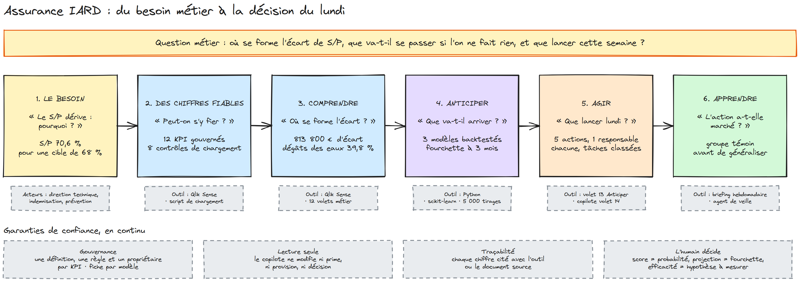

> Schémas dessinés avec Excalidraw et modifiables : ouvrez [design/fil-du-projet.excalidraw](design/fil-du-projet.excalidraw)
> ou [design/architecture.excalidraw](design/architecture.excalidraw) sur [excalidraw.com](https://excalidraw.com) (Menu › Ouvrir).

## Le projet

Un démonstrateur de « BI augmentée » pour l'assurance dommages (IARD habitation et garantie loyers impayés).
Il part d'un tableau de bord Qlik Sense classique et lui ajoute ce qui manque d'ordinaire entre le constat et la décision :
des modèles qui anticipent, un plan d'action chiffré en fourchette, un briefing hebdomadaire et un copilote
qui répond en citant ses sources. Tout tourne en local, en lecture seule, sur des **données synthétiques**.

## Le besoin métier

Une direction technique IARD voit son ratio sinistres / primes (S/P) dériver. Le tableau de bord dit *combien* ;
il ne dit ni *pourquoi*, ni *ce qui va arriver*, ni *quoi faire*. Trois questions reviennent chaque semaine :

1. **Où se forme l'écart à la cible ?** Quelle région, quelle garantie, quels dossiers.
2. **Que va-t-il se passer si l'on ne fait rien ?** Une tendance chiffrée, avec son incertitude.
3. **Que lancer lundi, et qui s'en charge ?** Des actions concrètes, un responsable, une mesure d'efficacité.

Point de départ : **S/P 2026 de 70,6 % pour une cible de 68 %**, soit **813 800 €** de charge au-delà de la cible
sur 31,8 M€ de primes.

## La solution mise en place

| Étape | Ce qui a été fait | Outil |
|---|---|---|
| 1. Des chiffres fiables | 12 KPI gouvernés (définition, règle, propriétaire), 8 contrôles de chargement bloquants | Qlik Sense, script de chargement |
| 2. Comprendre | 12 volets métier : écart par région, poids des garanties (dégâts des eaux 39,8 % de la charge) | Qlik Sense |
| 3. Anticiper | 3 modèles validés sur une période jamais vue : dégâts des eaux à 10 mois, coût final d'un sinistre, premier impayé GLI à 90 jours | Python, scikit-learn |
| 4. Agir | 5 actions chiffrées en fourchette (5 000 tirages), un responsable chacune, tâches classées par l'IA | Volet 13 « Anticiper » |
| 5. Demander | Copilote : 7 outils en lecture seule, chaque réponse affiche les outils interrogés et les documents cités | Serveur MCP, LLM local, volet 14 |
| 6. Apprendre | Briefing hebdomadaire : 5 signaux avec seuil et responsable ; groupe témoin avant de généraliser | Agent de veille |

Garanties de confiance, appliquées partout :

- **Lecture seule** : le copilote ne modifie ni prime, ni provision, ni décision.
- **Les chiffres sont calculés, jamais rédigés** : le LLM local ne fait que comprendre la question et reformuler des documents ; une réponse est rejetée si elle contient un nombre absent des sources.
- **Traçabilité** : chaque chiffre est cité avec l'outil ou le document dont il vient.
- **L'humain décide** : un score est une probabilité, une projection une fourchette, une efficacité une hypothèse à mesurer.

## Les 15 onglets de l'application

Captures de l'application Qlik Sense (données synthétiques). Chaque onglet répond à une question précise ;
le [schéma du parcours](https://cnanaj-wq.github.io/veloriax-assurance-labs/diagrammes/parcours-onglets.html) montre comment ils s'enchaînent.

| Onglet | La question à laquelle il répond |
|---|---|
| Accueil | Combien pèse le portefeuille ? |
| 01 Décider | Où est l'écart à la cible et que faut-il décider ? |
| 02 Comprendre | Quelle garantie forme la charge ? |
| 03 Indemniser | Quels dossiers bloquent ou coûtent le plus ? |
| 04 Renouveler | Quels contrats revoir avant l'échéance ? |
| 05 Simuler | Un levier de prévention suffit-il ? |
| 06 Prévenir | Quels baux GLI risquent l'impayé ? |
| 07 Recouvrer | Où en sont les dossiers d'impayés ? |
| 08 Rejouer | Comment le ratio a-t-il dérivé mois après mois ? |
| 09 Carte | Quels territoires et quels risques ? |
| 10 Fiabiliser | Les chiffres chargés sont-ils justes ? |
| 11 Évaluer | Quelle preuve exiger d'une solution IA ? |
| 12 Suivre | Quel parcours a suivi un client ? |
| 13 Anticiper | Que voient venir les modèles et que lancer ? |
| 14 Copiloter | Que répond le copilote, et sur quelles sources ? |

### Accueil · la porte d'entrée

Quatre chiffres du portefeuille : 31,84 M€ de primes, 22,47 M€ de charges, ratio sinistres / primes (S/P) de 70,6 % pour une cible de 68 %,
12 000 contrats répartis dans 120 agences et 5 régions. Le bandeau rappelle qu'il s'agit d'un prototype sur données synthétiques.

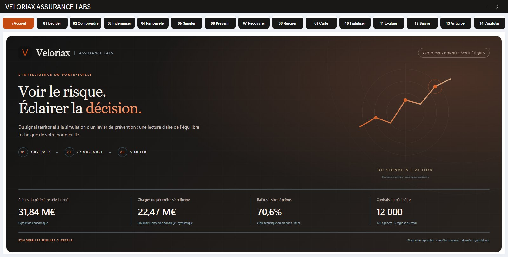

### 01 · Décider · repérer l'écart, l'expliquer, décider, suivre

Cinq indicateurs avec leur tendance mensuelle, dont l'écart à la cible (+814 k€) et le nombre de régions au-dessus de 68 % (4 sur 5).
Le S/P par région, sur un trait de référence à 68 %, montre où enquêter : Auvergne-Rhône-Alpes à 74,9 %, Île-de-France seule sous la cible à 61,5 %.
L'encadré suit les cinq temps de la décision (détecter, expliquer, recommander, décider, suivre) et le tableau traduit chaque région en euros d'écart.

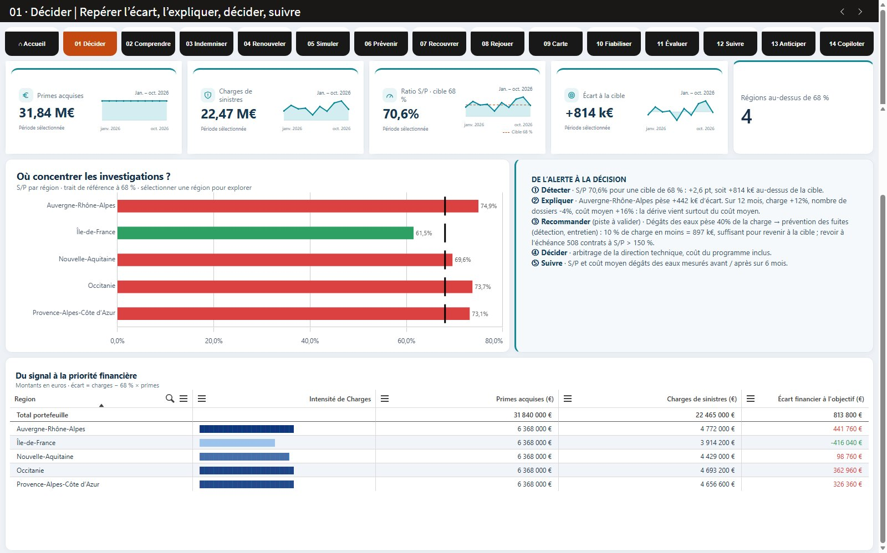

### 02 · Comprendre · où se concentre la charge

Charge par garantie : les dégâts des eaux dominent (8,97 M€, environ 40 %), devant l'incendie, le vol et le vandalisme.
Une courbe compare primes et charges mois par mois et une matrice régions × garanties croise charges et nombre d'écritures.
L'onglet oriente l'enquête sans prétendre prouver une cause.

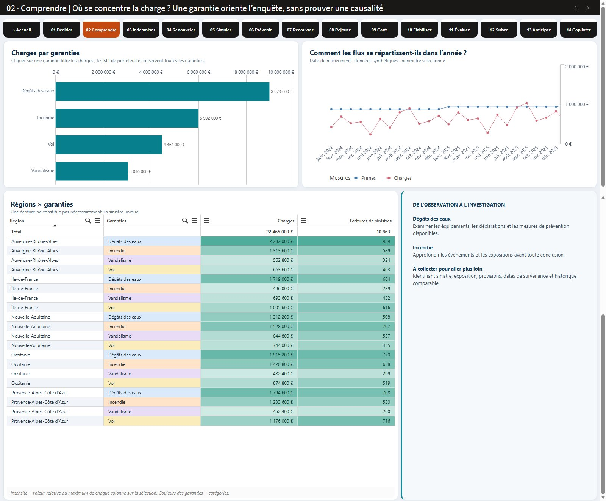

### 03 · Indemniser · dossiers, délais et recours

Six indicateurs de gestion des sinistres : 1 033 dossiers ouverts, 1,67 M€ provisionnés, 6,3 jours de délai de déclaration, 54 jours de durée de gestion, 32 % de recours encaissés.
Les graphiques montrent le stock par ancienneté, les 8 premières causes, la charge de travail des 15 gestionnaires et les dossiers les plus provisionnés.
Un score de suspicion à quatre règles lisibles liste les dossiers à contrôler (un signal oriente le contrôle, il ne prouve pas une fraude).

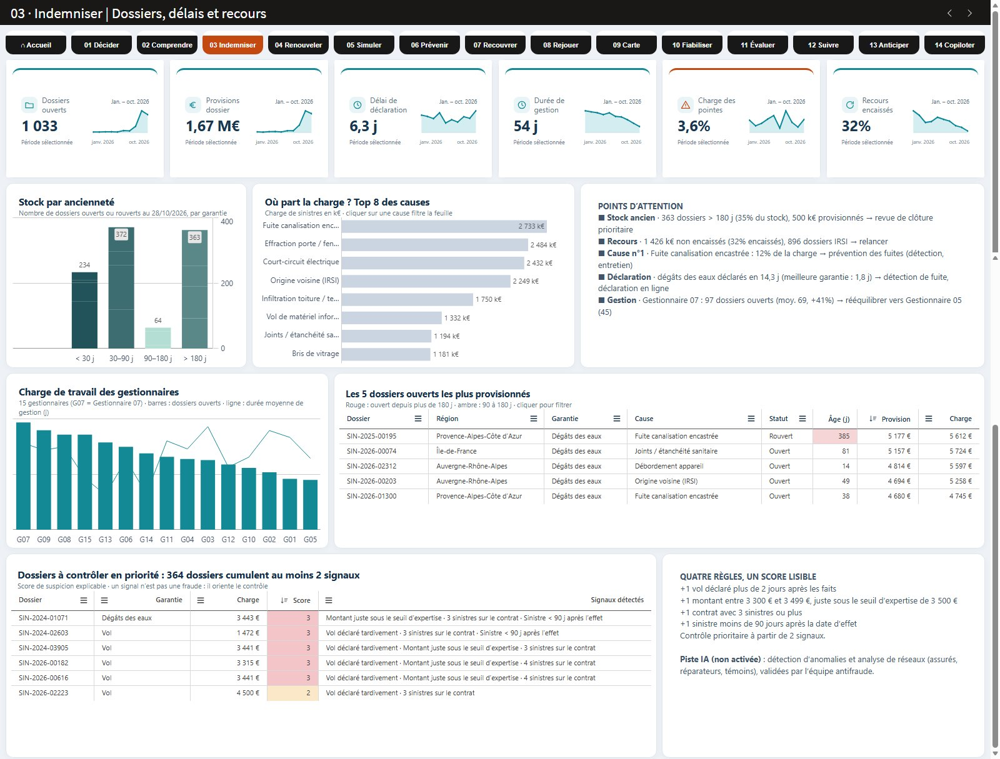

### 04 · Renouveler · rentabilité par segment et contrats à revoir

S/P par activité assurée (le coworking dépasse 110 %), les 6 agences qui creusent le plus l'écart, puis les 508 contrats à S/P supérieur à 150 %
arrivant à échéance dans les 3 mois, avec une piste d'action calculée par règle (revoir la franchise, prévention des fuites) à valider par le souscripteur.
Un dernier graphique croise canal de distribution et ancienneté du client.

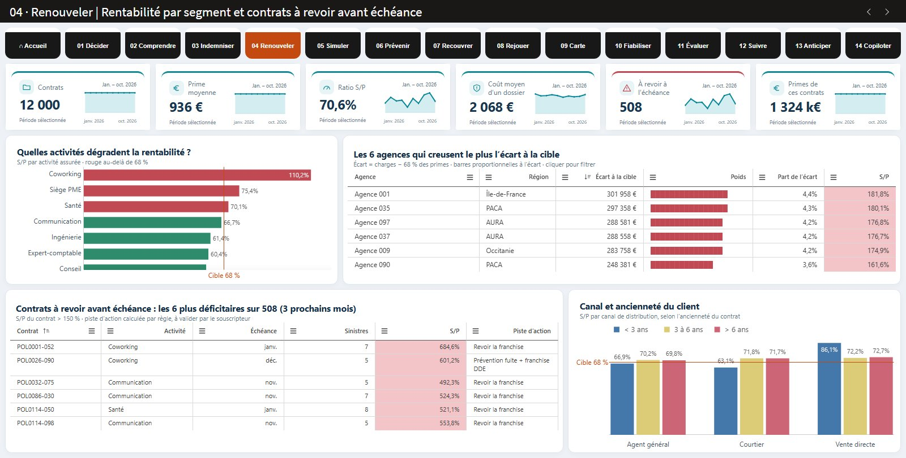

### 05 · Simuler · un levier de prévention suffit-il ?

Quatre boutons (0, 5, 10 ou 20 % de réduction des dégâts des eaux) recalculent la charge évitée, le S/P simulé et l'écart résiduel.
Le graphique avant / après compare la cible, le scénario et la situation actuelle. Le gain affiché est brut, avant le coût du programme :
l'onglet sert à cadrer un pilote, pas à promettre un résultat.

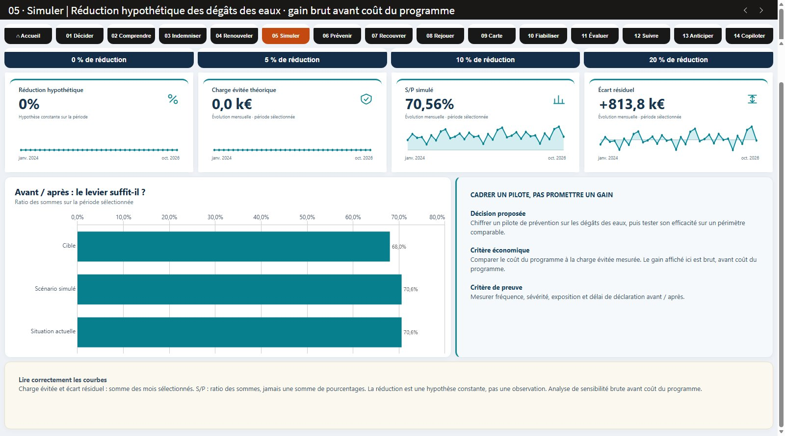

### 06 · Prévenir · loyers impayés, signaux et interventions

Pour la garantie loyers impayés (GLI) : taux d'impayés de 2,2 %, 540 baux en vigilance élevée, 280 baux en impayé, signal détecté avant l'impayé dans 34 % des cas.
Un score explicable (retards, taux d'effort, type de contrat) classe les baux ; le taux d'effort apparaît comme premier facteur de risque.
Deux listes de travail : les 5 baux à appeler cette semaine avec l'action proposée, et 5 dossiers ouverts à débloquer.

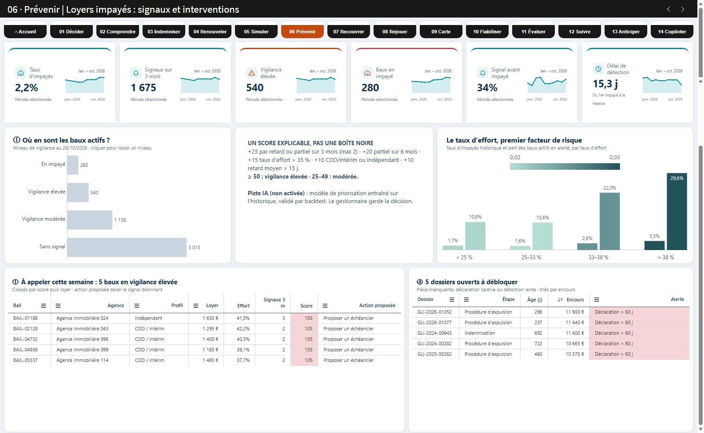

### 07 · Recouvrer · suivi, délais et montants

Le parcours des dossiers d'impayés étape par étape (premier impayé, relance, mise en demeure, commandement, déclaration, indemnisation, expulsion, recouvrement, clôture),
les délais selon un suivi automatisé ou manuel, la tendance des nouveaux impayés, les montants indemnisés et recouvrés par année et la performance par gestionnaire.
Le [cycle de vie d'un dossier GLI](https://cnanaj-wq.github.io/veloriax-assurance-labs/diagrammes/dossier-gli.html) détaille ces étapes.

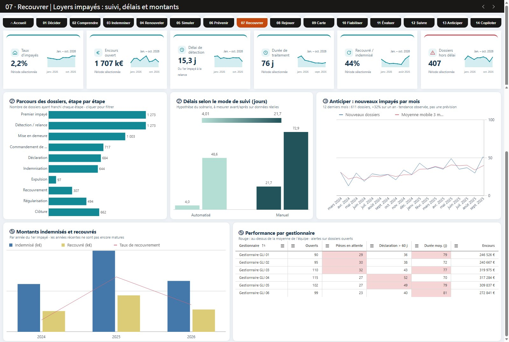

### 08 · Rejouer · la sinistralité mois par mois

Un bouton lecture fait avancer les mois de janvier 2024 à octobre 2026 : S/P glissant sur 12 mois (74,4 % fin octobre 2026), charge, coût moyen et nombre de dossiers suivent.
La matrice régions × garanties, la trajectoire du S/P contre la cible et un commentaire du mois rejoué montrent où la dérive s'installe.

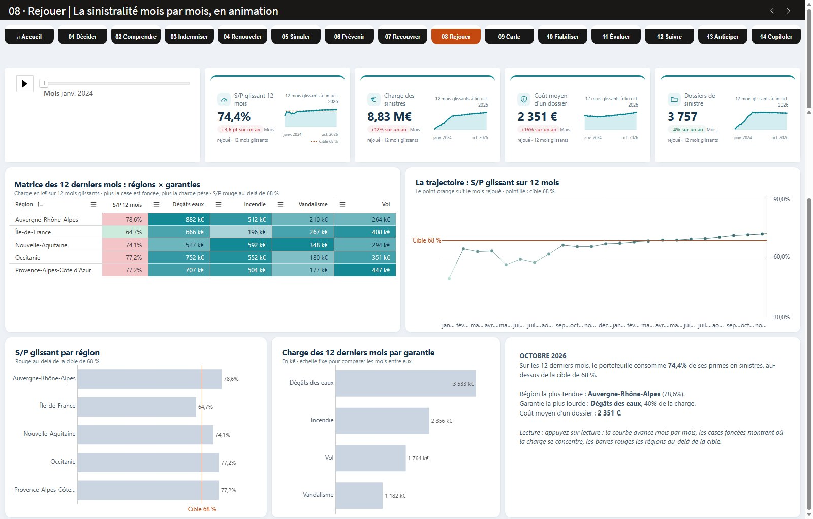

### 09 · Carte · territoires et garanties

Six boutons choisissent l'indicateur affiché sur la carte des régions (primes, charges, S/P observé, charge évitée, S/P simulé, écart résiduel).
Une seconde carte place un diagramme par région pour lire la composition de la charge par garantie.

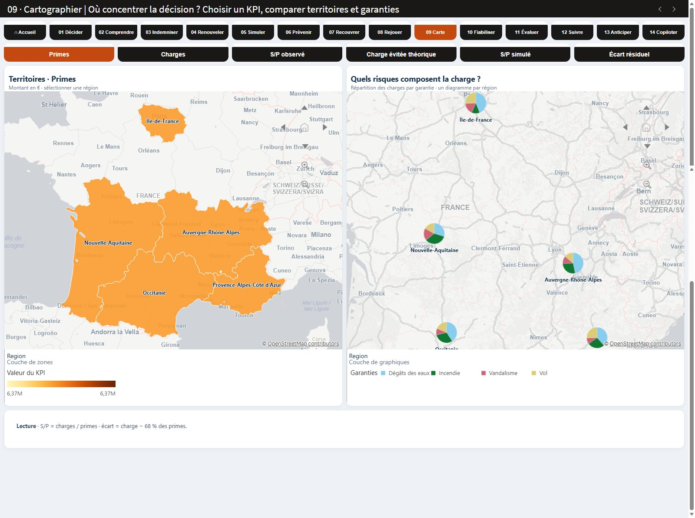

### 10 · Fiabiliser · contrôles sources / moteur

Huit contrôles indépendants des sélections comparent les sources et le modèle chargé : nombre de contrats et de mouvements, sommes des primes et des charges,
doublons, montants manquants, types non reconnus, contrats orphelins. Les huit sont conformes (écart de 0 €) ; la date du dernier rechargement est affichée.

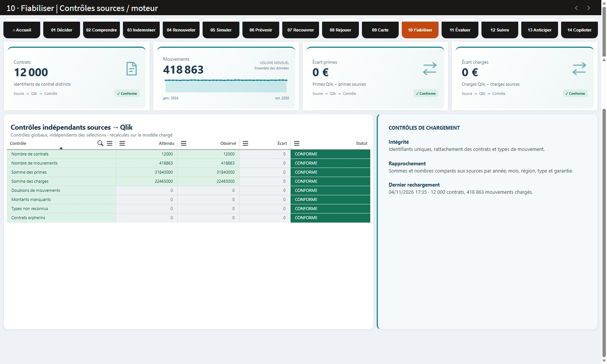

### 11 · Évaluer · solutions IA et preuves

Un catalogue de 28 cas d'usage IA classés par domaine (sinistres, rentabilité, fraude, client, climat, conformité). Pour chacun : la solution proposée,
le résultat à mesurer, la preuve à produire et les données nécessaires. L'en-tête l'affiche clairement : 0 modèle IA validé ici.

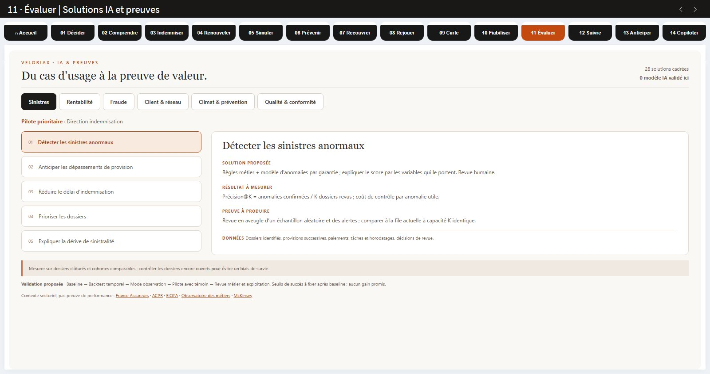

### 12 · Suivre · souscription et résiliation

La chronologie d'un client fictif, du devis à la résiliation, avec le délai entre chaque étape. Trois exemples (client résilié, client actif, devis abandonné)
viennent d'une cohorte CRM indépendante de 1 200 clients et 6 800 événements. Un motif déclaré n'est pas présenté comme une cause.

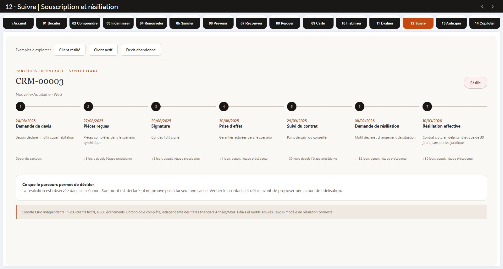

### 13 · Anticiper · ce que l'IA voit venir, et ce qu'il faut faire

Les sorties des trois modèles : 1 200 contrats à risque élevé de dégât des eaux, 79 provisions probablement insuffisantes, 204 baux en alerte d'impayé à 90 jours.
La projection du S/P glissant sur 3 mois (5 000 tirages) compare « sans action » et « avec le plan » en fourchette. Le plan liste 5 actions avec leur effet médian ;
trois tableaux donnent les contrats à équiper, les provisions à revoir et les tâches de la semaine.

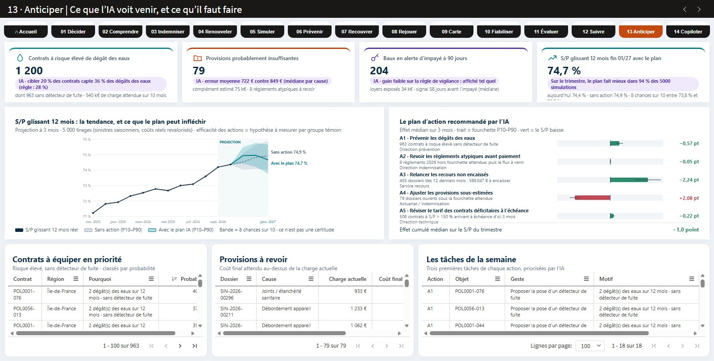

### 14 · Copiloter · demander, vérifier, décider

Le copilote répond aux questions sur le portefeuille et affiche, sous chaque réponse, les outils interrogés et les documents cités.
À côté : les KPI gouvernés (définition, règle, propriétaire), les fiches des modèles avec leurs limites et la charte d'usage de l'IA.
Le [schéma du copilote](https://cnanaj-wq.github.io/veloriax-assurance-labs/diagrammes/copilote.html) montre le trajet d'une question.

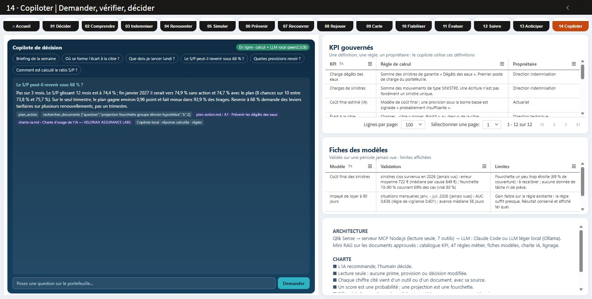

## L'architecture

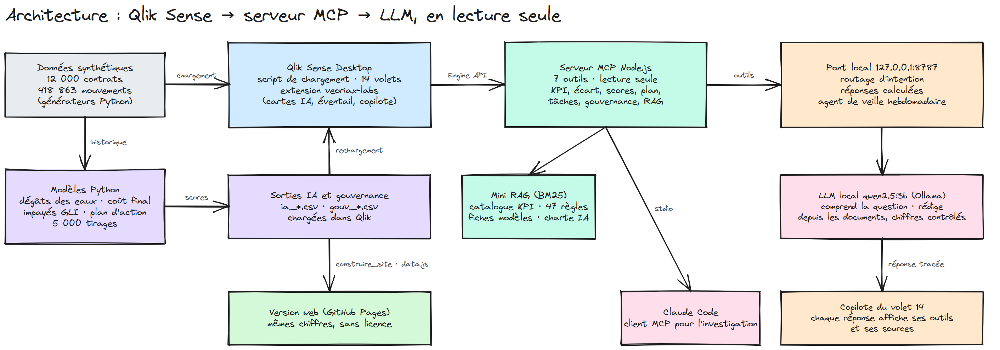

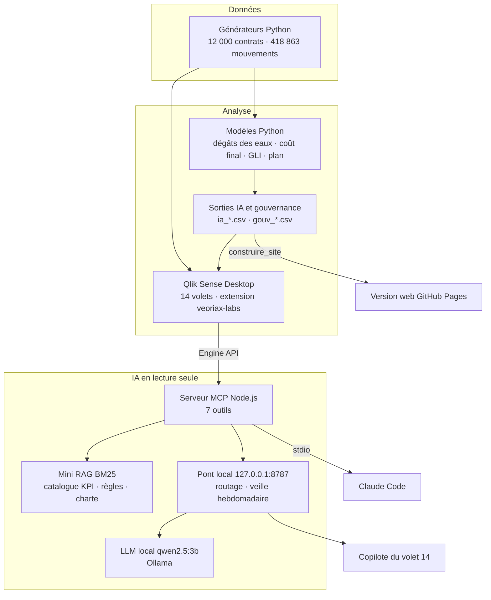

- **Qlik Sense reste la source de vérité** : le serveur MCP interroge l'application par l'Engine API (objets de session, rien n'est enregistré).
- **Le LLM est local** (Ollama) : aucune donnée ne sort du poste.
- **La version web** reprend les mêmes sorties via `source/ia/construire_site.mjs`, qui écrit `data.js`.

### Scénarios de fonctionnement

| Situation | Ce qui se passe | Ce que voit l'utilisateur |
|---|---|---|
| Question chiffrée (« Où se forme l'écart ? ») | Règle d'intention → outils MCP → texte calculé | Réponse, outils interrogés, sources |
| Question libre non reconnue | Le LLM classe l'intention (JSON), puis mêmes outils | Réponse calculée, moteur indiqué |
| Question de définition (« Comment est calculé le S/P ? ») | Catalogue gouverné, sinon RAG + rédaction contrôlée | Définition, règle, propriétaire, document cité |
| LLM absent ou arrêté | Règles seules | Le copilote répond, sans reformulation |
| Pont local arrêté | Le volet 14 rejoue les sessions enregistrées | Badge « Hors ligne · sessions enregistrées » |
| Qlik fermé | L'outil échoue, le pont renvoie l'erreur | Message d'erreur, aucune réponse inventée |
| Lundi matin | Agent de veille : 5 signaux évalués | Briefing de la semaine, alerte et responsable |

## Les schémas interactifs

Cinq schémas HTML autonomes, à explorer dans le navigateur (zoom, recherche, vues guidées, thème clair ou sombre, export).
Ils sont regroupés sur la page **https://cnanaj-wq.github.io/veloriax-assurance-labs/diagrammes/**.

| Schéma | Ce qu'il montre |
|---|---|
| [Parcours des 15 onglets](https://cnanaj-wq.github.io/veloriax-assurance-labs/diagrammes/parcours-onglets.html) | Le fil de la décision (Accueil → Décider → Comprendre → Simuler → Anticiper → Copiloter), les zooms métier, le contexte et la confiance |
| [Des données aux onglets](https://cnanaj-wq.github.io/veloriax-assurance-labs/diagrammes/donnees.html) | Générateurs Python, 11 fichiers sources, enrichissement IA, 19 fichiers rechargés, 8 contrôles, restitution |
| [Cycle de vie d'un dossier GLI](https://cnanaj-wq.github.io/veloriax-assurance-labs/diagrammes/dossier-gli.html) | Du premier impayé à la clôture : voie amiable, voie assurance, cas lourd |
| [Une question au copilote](https://cnanaj-wq.github.io/veloriax-assurance-labs/diagrammes/copilote.html) | Routage par règles, calcul par les outils, recherche documentaire, rédaction contrôlée |
| [Déploiement](https://cnanaj-wq.github.io/veloriax-assurance-labs/diagrammes/deploiement.html) | Poste local, Qlik Cloud et Claude relié par le connecteur Qlik MCP |

Les spécifications sont dans [design/archify/](design/archify/) ; les schémas sont générés et validés avec Archify.
Les libellés de l'interface du lecteur (« Guided views », « Legend »…) restent en anglais.

### Mise en ligne sur Qlik Cloud et accès par Claude

L'application a aussi été importée dans un espace personnel Qlik Cloud : le fichier QVF, ses 19 fichiers de données dans DataFiles et l'extension `veoriax-labs`.
Le rechargement retrouve les mêmes chiffres qu'en local (31,84 M€ de primes, S/P 70,6 %, écart +814 k€).
Claude l'interroge en lecture par le serveur Qlik MCP du tenant, après authentification OAuth : par exemple, quatre régions sur cinq au-dessus de la cible
et 8,97 M€ de charge pour les dégâts des eaux. Ce tenant est un essai ; l'application n'y est pas publiée.

## Le logigramme de décision

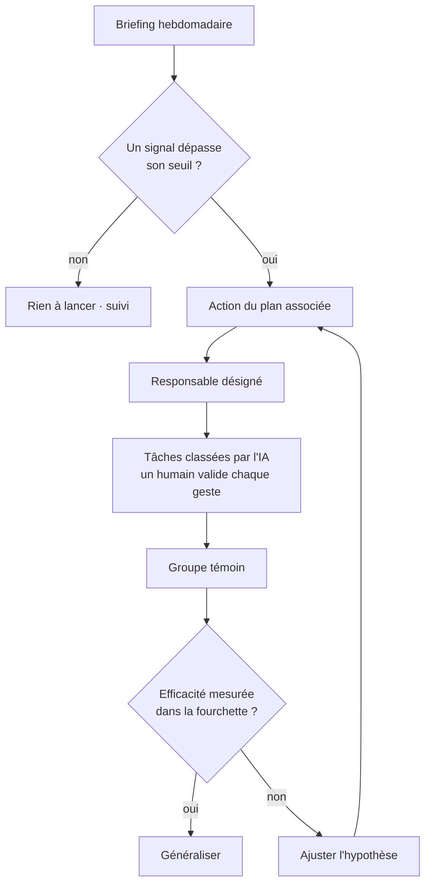

Et le parcours d'une question posée au copilote :

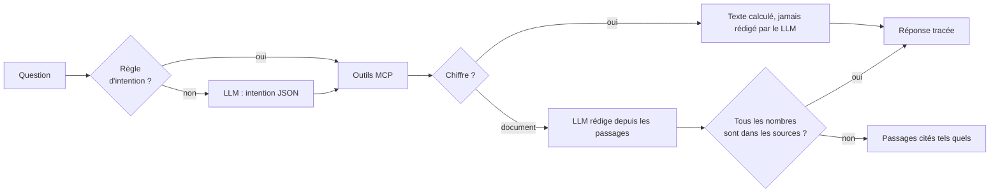

| Signal (briefing) | Seuil | Responsable | Action |
|---|---|---|---|
| S/P glissant 12 mois au-dessus de la cible | + 3 points | Direction technique | Plan complet |
| Dégâts des eaux > 35 % de la charge | 35 % | Direction prévention | A1 détecteurs de fuite |
| Provisions probablement insuffisantes | 50 dossiers | Direction indemnisation | A4 ajustement |
| Recours à encaisser | 300 000 € | Service recours | A3 relances |
| Baux GLI en alerte d'impayé | 150 baux | Gestion GLI | Contact préventif |

## L'impact métier

- **Où agir** : Auvergne-Rhône-Alpes (441 760 €), Occitanie et Provence-Alpes-Côte d'Azur concentrent l'écart ; les dégâts des eaux pèsent 39,8 % de la charge.
- **Qui cibler** : 963 contrats à risque élevé de dégât des eaux sans détecteur ; 455 recours non encaissés (588 047 €) ; 79 provisions sous-estimées ; 204 baux GLI en alerte.
- **Ce que le plan peut changer** : sur le prochain trimestre, S/P médian de 73,4 % sans action contre 72,4 % avec le plan ; le plan fait mieux dans 94 % des 5 000 scénarios. La relance des recours (A3) pèse le plus : 68 694 € médians sur 3 mois.
- **Un arbitrage rendu visible** : ajuster les provisions (A4) dégrade le S/P à court terme (– 2,08 points) mais évite une mauvaise surprise à la clôture.

Ce qu'il faut lire honnêtement : la cible de 68 % ne se rejoint pas en un trimestre (S/P glissant 12 mois de 74,7 % fin janvier 2027
avec le plan, contre 74,9 % sans). Les modèles battent une règle simple sans être spectaculaires (AUC 0,64 contre 0,57 pour les dégâts des eaux).
Les efficacités sont des hypothèses à mesurer par groupe témoin. Rien ici n'est validé en production.

## Le dashboard en ligne

La version web reprend cinq écrans du démonstrateur sans licence Qlik :

- **Synthèse** : écart par région (cliquable) et poids des garanties.
- **Anticiper** : les 3 modèles, leur preuve et leur limite, et les listes de travail produites.
- **Plan d'action** : éventail du S/P glissant, effet de chaque action en fourchette, tâches de la semaine.
- **Copilote** : réponses enregistrées avec leur trace, briefing de la semaine.
- **Gouvernance** : charte d'usage de l'IA, contrôles, KPI gouvernés, fiches des modèles.

Pour l'ouvrir en local :

```bash
python -m http.server 8000
```

puis `http://localhost:8000` (les schémas : `http://localhost:8000/diagrammes/`). Le dossier [source/](source/) contient le code : scripts de chargement Qlik, générateurs de données,
modèles Python, serveur MCP, pont, agent de veille et extension Qlik `veoriax-labs`.

## Source des données

**Données entièrement synthétiques**, produites par les générateurs Python du dossier `source/` : 12 000 contrats habitation,
418 863 mouvements de sinistres et de primes, 4 094 baux GLI. Aucun chiffre ne provient d'un assureur réel ;
les noms de régions servent uniquement à rendre la démonstration lisible.

---

Cédric NANA · Consultant Data Analytics · Qlik Sense, Python, MCP, IA générative locale
