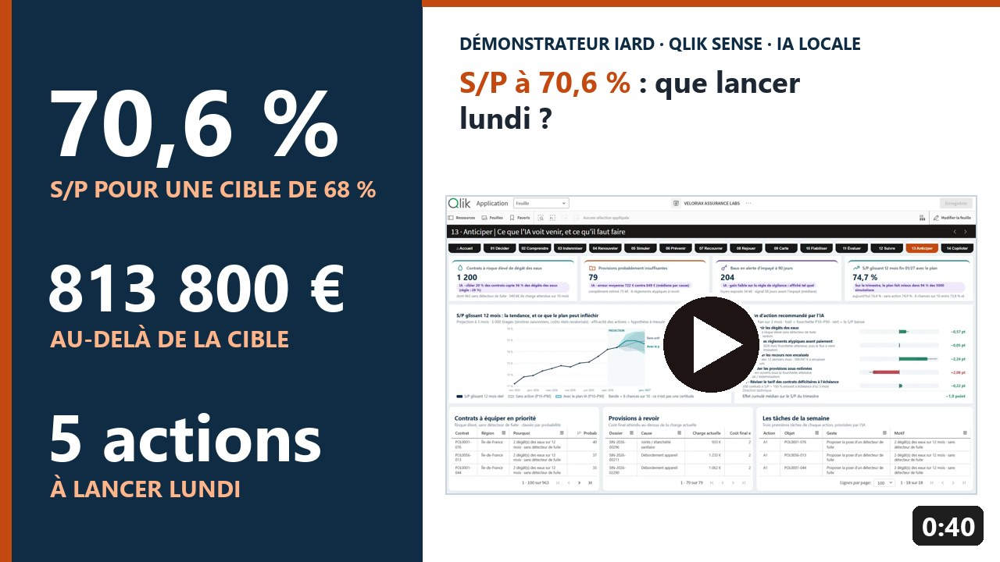
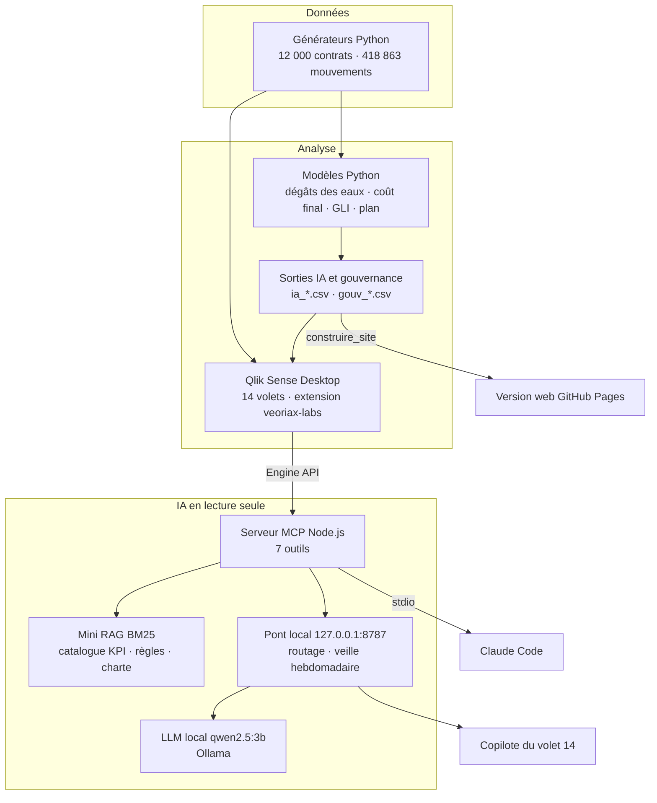
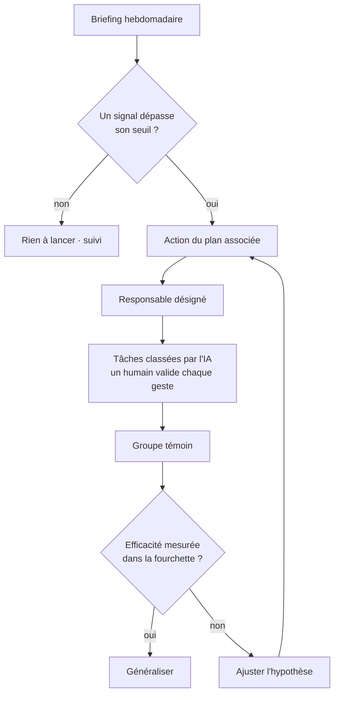
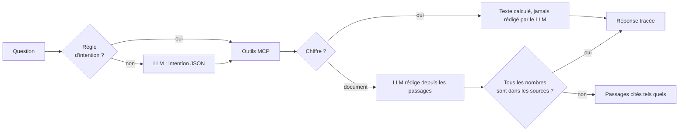

# Veloriax Assurance Labs : de « ce qui s'est passé » à « ce qu'on lance lundi »

<a href="README.md"></a>&nbsp;<a href="README.en.md"></a>

## Le projet en vidéo

<table>
  <tr>
    <td width="420" valign="top">
      <a href="https://cnanaj-wq.github.io/veloriax-assurance-labs/video.html"></a>
    </td>
    <td valign="top">
      <a href="https://cnanaj-wq.github.io/veloriax-assurance-labs/video.html"><b>S/P à 70,6 % pour une cible de 68 % : que lancer lundi ?</b></a><br><br>
      Cédric NANA · Consultant Data Analytics<br>
      ▷ 0:40 · vidéo sans voix off<br><br>
      Qlik Sense mesure, trois modèles Python anticipent, un copilote tracé répond : le projet en 40 secondes.
    </td>
  </tr>
</table>

**Voir le dashboard interactif : https://cnanaj-wq.github.io/veloriax-assurance-labs/**


> Schémas dessinés avec Excalidraw et modifiables : ouvrez [design/fil-du-projet.excalidraw](design/fil-du-projet.excalidraw)
> ou [design/architecture.excalidraw](design/architecture.excalidraw) sur [excalidraw.com](https://excalidraw.com) (Menu › Ouvrir).

## Le projet

Un démonstrateur de « BI augmentée » pour l'assurance dommages (IARD habitation et garantie loyers impayés).
Il part d'un tableau de bord Qlik Sense classique et lui ajoute ce qui manque d'ordinaire entre le constat et la décision :
des modèles qui anticipent, un plan d'action chiffré en fourchette, un briefing hebdomadaire et un copilote
qui répond en citant ses sources. Tout tourne en local, en lecture seule, sur des **données synthétiques**.

## Le besoin métier

Une direction technique IARD voit son ratio sinistres / primes (S/P) dériver. Le tableau de bord dit *combien* ;
il ne dit ni *pourquoi*, ni *ce qui va arriver*, ni *quoi faire*. Trois questions reviennent chaque semaine :

1. **Où se forme l'écart à la cible ?** Quelle région, quelle garantie, quels dossiers.
2. **Que va-t-il se passer si l'on ne fait rien ?** Une tendance chiffrée, avec son incertitude.
3. **Que lancer lundi, et qui s'en charge ?** Des actions concrètes, un responsable, une mesure d'efficacité.

Point de départ : **S/P 2026 de 70,6 % pour une cible de 68 %**, soit **813 800 €** de charge au-delà de la cible
sur 31,8 M€ de primes.

## La solution mise en place

| Étape | Ce qui a été fait | Outil |
|---|---|---|
| 1. Des chiffres fiables | 12 KPI gouvernés (définition, règle, propriétaire), 8 contrôles de chargement bloquants | Qlik Sense, script de chargement |
| 2. Comprendre | 12 volets métier : écart par région, poids des garanties (dégâts des eaux 39,8 % de la charge) | Qlik Sense |
| 3. Anticiper | 3 modèles validés sur une période jamais vue : dégâts des eaux à 10 mois, coût final d'un sinistre, premier impayé GLI à 90 jours | Python, scikit-learn |
| 4. Agir | 5 actions chiffrées en fourchette (5 000 tirages), un responsable chacune, tâches classées par l'IA | Volet 13 « Anticiper » |
| 5. Demander | Copilote : 7 outils en lecture seule, chaque réponse affiche les outils interrogés et les documents cités | Serveur MCP, LLM local, volet 14 |
| 6. Apprendre | Briefing hebdomadaire : 5 signaux avec seuil et responsable ; groupe témoin avant de généraliser | Agent de veille |

Garanties de confiance, appliquées partout :

- **Lecture seule** : le copilote ne modifie ni prime, ni provision, ni décision.
- **Les chiffres sont calculés, jamais rédigés** : le LLM local ne fait que comprendre la question et reformuler des documents ; une réponse est rejetée si elle contient un nombre absent des sources.
- **Traçabilité** : chaque chiffre est cité avec l'outil ou le document dont il vient.
- **L'humain décide** : un score est une probabilité, une projection une fourchette, une efficacité une hypothèse à mesurer.

## L'architecture




- **Qlik Sense reste la source de vérité** : le serveur MCP interroge l'application par l'Engine API (objets de session, rien n'est enregistré).
- **Le LLM est local** (Ollama) : aucune donnée ne sort du poste.
- **La version web** reprend les mêmes sorties via `source/ia/construire_site.mjs`, qui écrit `data.js`.

### Scénarios de fonctionnement

| Situation | Ce qui se passe | Ce que voit l'utilisateur |
|---|---|---|
| Question chiffrée (« Où se forme l'écart ? ») | Règle d'intention → outils MCP → texte calculé | Réponse, outils interrogés, sources |
| Question libre non reconnue | Le LLM classe l'intention (JSON), puis mêmes outils | Réponse calculée, moteur indiqué |
| Question de définition (« Comment est calculé le S/P ? ») | Catalogue gouverné, sinon RAG + rédaction contrôlée | Définition, règle, propriétaire, document cité |
| LLM absent ou arrêté | Règles seules | Le copilote répond, sans reformulation |
| Pont local arrêté | Le volet 14 rejoue les sessions enregistrées | Badge « Hors ligne · sessions enregistrées » |
| Qlik fermé | L'outil échoue, le pont renvoie l'erreur | Message d'erreur, aucune réponse inventée |
| Lundi matin | Agent de veille : 5 signaux évalués | Briefing de la semaine, alerte et responsable |

## Le logigramme de décision



Et le parcours d'une question posée au copilote :



| Signal (briefing) | Seuil | Responsable | Action |
|---|---|---|---|
| S/P glissant 12 mois au-dessus de la cible | + 3 points | Direction technique | Plan complet |
| Dégâts des eaux > 35 % de la charge | 35 % | Direction prévention | A1 détecteurs de fuite |
| Provisions probablement insuffisantes | 50 dossiers | Direction indemnisation | A4 ajustement |
| Recours à encaisser | 300 000 € | Service recours | A3 relances |
| Baux GLI en alerte d'impayé | 150 baux | Gestion GLI | Contact préventif |

## L'impact métier

- **Où agir** : Auvergne-Rhône-Alpes (441 760 €), Occitanie et Provence-Alpes-Côte d'Azur concentrent l'écart ; les dégâts des eaux pèsent 39,8 % de la charge.
- **Qui cibler** : 963 contrats à risque élevé de dégât des eaux sans détecteur ; 455 recours non encaissés (588 047 €) ; 79 provisions sous-estimées ; 204 baux GLI en alerte.
- **Ce que le plan peut changer** : sur le prochain trimestre, S/P médian de 73,4 % sans action contre 72,4 % avec le plan ; le plan fait mieux dans 94 % des 5 000 scénarios. La relance des recours (A3) pèse le plus : 68 694 € médians sur 3 mois.
- **Un arbitrage rendu visible** : ajuster les provisions (A4) dégrade le S/P à court terme (– 2,08 points) mais évite une mauvaise surprise à la clôture.

Ce qu'il faut lire honnêtement : la cible de 68 % ne se rejoint pas en un trimestre (S/P glissant 12 mois de 74,7 % fin janvier 2027
avec le plan, contre 74,9 % sans). Les modèles battent une règle simple sans être spectaculaires (AUC 0,64 contre 0,57 pour les dégâts des eaux).
Les efficacités sont des hypothèses à mesurer par groupe témoin. Rien ici n'est validé en production.

## Le dashboard en ligne

La version web reprend cinq écrans du démonstrateur sans licence Qlik :

- **Synthèse** : écart par région (cliquable) et poids des garanties.
- **Anticiper** : les 3 modèles, leur preuve et leur limite, et les listes de travail produites.
- **Plan d'action** : éventail du S/P glissant, effet de chaque action en fourchette, tâches de la semaine.
- **Copilote** : réponses enregistrées avec leur trace, briefing de la semaine.
- **Gouvernance** : charte d'usage de l'IA, contrôles, KPI gouvernés, fiches des modèles.

Pour l'ouvrir en local :

```bash
python -m http.server 8000
```

puis `http://localhost:8000`. Le dossier [source/](source/) contient le code : scripts de chargement Qlik, générateurs de données,
modèles Python, serveur MCP, pont, agent de veille et extension Qlik `veoriax-labs`.

## Source des données

**Données entièrement synthétiques**, produites par les générateurs Python du dossier `source/` : 12 000 contrats habitation,
418 863 mouvements de sinistres et de primes, 4 094 baux GLI. Aucun chiffre ne provient d'un assureur réel ;
les noms de régions servent uniquement à rendre la démonstration lisible.

---

Cédric NANA · Consultant Data Analytics · Qlik Sense, Python, MCP, IA générative locale
